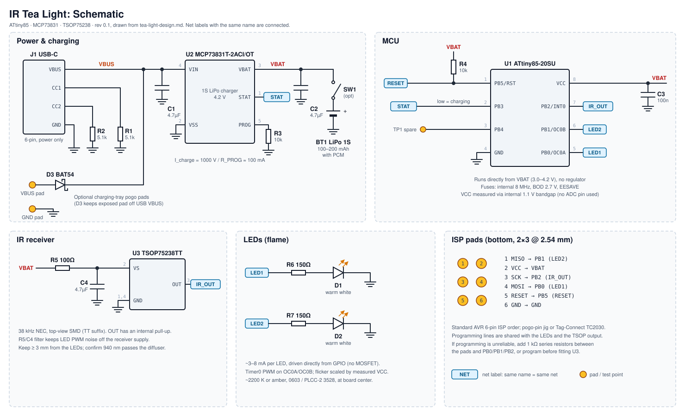

# TeaLight

A rechargeable, IR-controlled flameless tea light built around an ATtiny85. Home Assistant owns the schedule and sends NEC IR commands through an ESPHome IR blaster; each light only receives commands, flickers its LEDs, and manages its LiPo battery.



The full design spec is in [tea-light-design.md](tea-light-design.md).

## Hardware at a glance

| Block | Part | Notes |
|---|---|---|
| MCU | ATtiny85-20SU (SOIC-8) | Internal 8 MHz, runs directly from VBAT, no regulator |
| Charger | MCP73831T-2ACI/OT | 4.2 V, ~100 mA (R_PROG = 10 kΩ), STAT → PB3 |
| Power in | USB-C (power-only) + optional pogo tray pads | 5.1 kΩ CC pull-downs; BAT54 on the tray input |
| Battery | 1S LiPo, 100–200 mAh, with protection PCM | Optional slide switch for shipping |
| IR receiver | Vishay TSOP75238TT (38 kHz, top view) | 100 Ω / 4.7 µF supply filter, OUT → PB2 (INT0) |
| LEDs | 2 × warm white / amber, 150 Ω each | PWM on OC0A (PB0) and OC0B (PB1) |
| Programming | 6 ISP pads on the bottom | Pogo-pin jig or Tag-Connect TC2030 |

Target size: 32 mm round 2-layer PCB, 1.0 mm FR4, to fit a standard ~38 mm tea light shell.

## How it works

```
Home Assistant (sunset trigger, off after 6 h)
  -> ESPHome on ESP32-C3 + IR LED (NEC, address 0x5A)
    -> IR broadcast to the room
      -> each tea light: TSOP75238 -> ATtiny85 -> LEDs
```

NEC address `0x5A`:

| Command | Action |
|---|---|
| `0x01` | On |
| `0x02` | Off |
| `0x03` / `0x04` | Brightness up / down |
| `0x05` | Toggle flicker / steady |
| `0x06` | On with a local 6 h timer |
| `0x10`–`0x1F` | Group on |
| `0x20`–`0x2F` | Group off |

A learn mode (triggered on USB unplug) lets any spare NEC remote be paired as alternate On/Off codes.

## Repository layout

| Path | Contents | Status |
|---|---|---|
| `tea-light-design.md` | Design spec | Done |
| `docs/schematic.svg` | Circuit overview drawing | Done |
| `tea-light/` | KiCad project (schematic, PCB, JLCPCB outputs) | Planned |
| `firmware/` | PlatformIO project for the ATtiny85 (ATTinyCore) | Planned |
| `ir-blaster.yaml` | ESPHome config for the IR blaster, plus HA automations | Planned |

## Roadmap

1. KiCad schematic and ERC
2. 32 mm round PCB layout, DRC against JLCPCB 2-layer rules
3. Gerbers, drill, BOM, and CPL for JLCPCB assembly with LCSC part numbers
4. Firmware: state machine, flicker, VCC measurement, command set, learn mode
5. ESPHome IR blaster config and Home Assistant automations
6. Bring-up checklist: fuses, IR decode, current measurements, range through the shell

## Open questions

- Interior dimensions of the shell, and whether its diffuser passes 940 nm IR
- One LED or two
- USB-C per unit, a charging tray, or both
- Whether TSOP standby current justifies duty-cycling its supply
